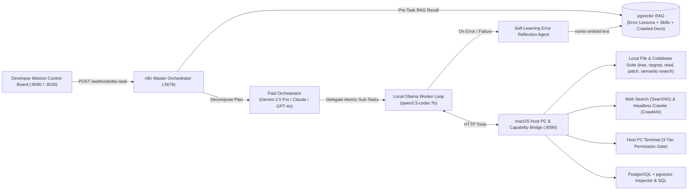

# n8n Personal AI Agent Orchestrator & Developer Mission Control Board

A self-hosted **Hybrid AI Agent Orchestration Platform** built on **n8n AI Agents** (`@n8n/n8n-nodes-langchain.agent`), **Local Ollama Workers** (`qwen2.5-coder:7b` + `nomic-embed-text`), **PostgreSQL + `pgvector` Self-Learning RAG**, **SearXNG + Crawl4AI Web Crawler**, and a **Developer Mission Control Board**.

---

## Architecture Overview



---

## Key Features

1. **Hybrid Paid Orchestrator + Free Local Worker Loop**:
   - **Paid Frontier LLM (Google Gemini 2.5 Pro / Anthropic Claude Sonnet / OpenAI GPT-4o)** runs only at the **Orchestrator** level: recalls self-learned RAG guardrails, inspects the workspace file tree, decomposes development prompts into atomic sub-tasks, and verifies final outputs.
   - **Local Ollama LLM (`qwen2.5-coder:7b`)** executes the iterative **Agent Tool Loop** for coding, file patching, web crawling, database inspection, and running unit tests at **\$0 API token cost**.
2. **Comprehensive Tool Suites (`host-bridge` on port `8090`)**:
   - **Local File & Codebase Intelligence (`/tools/fs/*`)**: Directory tree (`tree`), fast regex search (`grep` via `ripgrep`), semantic code search (`semantic-search` via `nomic-embed-text`), line-range file reader (`read`), surgical search-and-replace patching (`patch`), and file creation (`write`).
   - **Web Search & Deep Crawler (`/tools/web/*`)**: Multi-engine live web search (`search` via **SearXNG** + DuckDuckGo fallback), headless browser page scraping (`crawl-page` via **Crawl4AI / Playwright**), and recursive multi-page documentation ingestion (`deep-crawl` straight into `pgvector`).
   - **Host PC Terminal & 3-Tier Security Policy (`/tools/shell/*`)**: Configured in `config/permissions.yaml` with `AUTO_SAFE`, `WORKSPACE_WRITE`, `APPROVAL_REQUIRED` (1-click approval inbox on the Developer Board), and `BLOCKED`.
   - **Database Inspector & SQL Runner (`/tools/db/*`)**: Schema inspection (`schema`) and parameterized SQL execution (`query`).
3. **Self-Learning Episodic & Procedural RAG (`/tools/rag/*`)**:
   - Whenever an agent encounters an error or you teach it a lesson, `03-self-learning-error-rag.json` extracts the `root_cause` and `learned_rule`, embeds it with `nomic-embed-text` (768-dim), and stores it in `agent_error_lessons` (`pgvector`).
   - Before every new task, `/tools/rag/recall` automatically injects matching error lessons and procedural skills into the agent prompt.

---

## Repository Structure

- [scripts/start-all.sh](scripts/start-all.sh) — One-command launcher for n8n (`:5678`), Developer Mission Control Board (`:8090` / `:3030`), Local Ollama (`:11434`), and smoke verification.
- [scripts/stop-all.sh](scripts/stop-all.sh) — Cleanly stops all running local services and Docker containers.
- [scripts/verify-stack.sh](scripts/verify-stack.sh) — Validates workflow JSONs, permission policies, SQL schema, and runs `pytest`.
- [scripts/bootstrap.sh](scripts/bootstrap.sh) — Bootstraps `.env`, Ollama models, Python venv, and Docker Compose stack.
- [docker-compose.yml](docker-compose.yml) — Launches `n8n`, `postgres-rag` (`pgvector:pg16`), `searxng`, and `crawl4ai`.
- [db/init.sql](db/init.sql) — Unified PostgreSQL + `pgvector` schema and baseline self-learning RAG lessons.
- [config/permissions.yaml](config/permissions.yaml) — 3-tier security policy for filesystem, shell commands, SQL statements, and web crawling.
- [host-bridge/main.py](host-bridge/main.py) — FastAPI macOS Host PC & Capability Bridge + built-in Mission Control UI (`localhost:8090`).
- [dev-board/](dev-board/) — Next.js + Tailwind Developer Mission Control Board (`localhost:3030`).
- [workflows/](workflows/) — 4 importable n8n AI Agent workflows:
  - `01-master-orchestrator-agent.json`
  - `02-local-worker-agent-loop.json`
  - `03-self-learning-error-rag.json`
  - `04-skill-and-doc-ingestion-rag.json`

---

## Quick Start

```bash
# 1. Copy environment template and configure your API keys (optional for local-only mode)
cp .env.example .env

# 2. Start everything (n8n :5678, Mission Control Board :8090 & :3030, Ollama :11434)
chmod +x scripts/*.sh
./scripts/start-all.sh

# 3. Run full test & schema verification
./scripts/verify-stack.sh
```

### Live Interfaces
- **n8n Visual Workflows & Agents**: `http://localhost:5678`
- **Developer Mission Control Board**: `http://localhost:8090` (and `http://localhost:3030`)
- **Interactive Toolset Swagger API**: `http://localhost:8090/docs`
